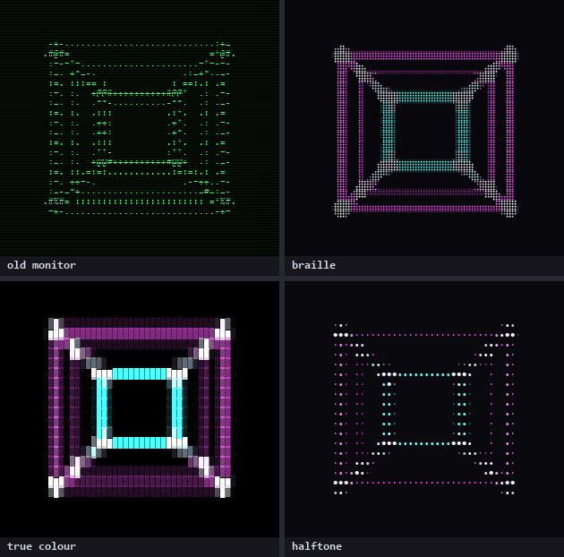
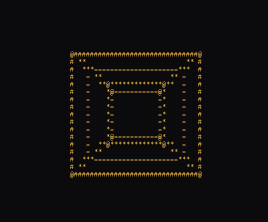
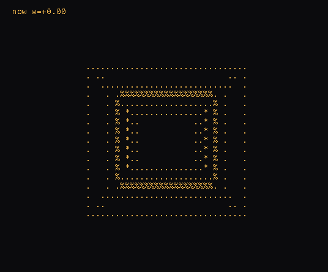

# ascii-tesseract

**A 4D cube turning in ASCII, and a converter that turns any picture, video or camera into characters.** Pure JavaScript, no dependencies, nothing uploaded anywhere.

> RU: тессеракт — четырёхмерный куб — вращается в ASCII. И конвертер: любая картинка, видео или камера → символы (брайль, блоки, точки, старый монитор…), прямо в браузере. Режим среза: мы живём в 3D и видим только срез, а «сейчас» скользит по четвёртой оси.

**Converter:** https://klavdiy-core.github.io/ascii-tesseract/convert.html · **tesseract:** https://klavdiy-core.github.io/ascii-tesseract/ · slice mode: https://klavdiy-core.github.io/ascii-tesseract/?slice



## Converter

Open `convert.html` (or the link above). Drop an image or a video on it, or press *camera*; the tesseract is the default source.

**Tweet shaders.** Press *tweet shader* and paste a GLSL one-liner of the kind posted under #つぶやきGLSL (twigl "geekest" style: `FC`, `r`, `t`, `o`, `hsv()`, `rotate2D()`, `rotate3D()`). It runs in WebGL2 and goes straight into the styles; hashtags in the paste are dropped. Compile errors are shown under the box. `shader.js` does this and works on its own: `Shader.create(code, w, h).frame(t)` returns the pixels.

- **Styles:** classic ` .:-=+*#%@`, detailed (70 characters), blocks `░▒▓█`, dots `·•●`, binary, braille (2×4 dots per character), or your own characters.
- **Presets:** old monitor, amber glow, digital rain, printed page, braille, true colour, halftone.
- **Tone:** detail (columns), brightness, contrast, gamma, invert, dot level for braille.
- **Colour:** mono ink, the picture's own colours (with a boost), or a palette by brightness; any background.
- **Effects:** bloom, scanlines, grain, vignette, flicker.
- **Save:** PNG, plain text, or record the canvas as a WebM video.

The engine is `ascii.js`, usable on its own:

```js
const Ascii = require('./ascii.js');                     // or <script src="ascii.js"> -> window.Ascii
const res = Ascii.render(imageData, { cols: 100, style: 'braille', colour: 'original' });
console.log(Ascii.toText(res));                          // res.cells[row][col] = { ch, rgb, lum }
Ascii.draw(canvas.getContext('2d'), res, { bloom: 0.5, scanlines: 0.3 });   // browser
```

`Tesseract.image(t, { width, height })` gives the tesseract itself as pixels (colour follows the fourth coordinate), which is how it feeds the converter.

| whole | slice |
|---|---|
|  |  |

## Run

```sh
npx github:klavdiy-core/ascii-tesseract          # or:
git clone https://github.com/klavdiy-core/ascii-tesseract && cd ascii-tesseract
node tesseract.js            # s = slice / whole, q = quit
node tesseract.js --slice --speed 0.5
node tesseract.js --frames 1 --width 80 --height 30   # print one frame and exit
node tesseract.js | head -40  # into a pipe: plain frames, no cursor codes, ends quietly when the reader does
node ascii.js photo.png --cols 100 --style detailed   # a picture as text, no browser
```

`ascii.js` reads PNG (8-bit, any colour type, not interlaced) with Node's own zlib, and binary PPM/PGM; nothing to
install. A JPEG or GIF is refused with the command that converts it (`ffmpeg -i in.jpg out.png`), or open
`convert.html`, which reads anything the browser can. In the terminal the cursor comes back however the animation
ends (q, Ctrl+C, a kill, an error), and a reader that goes away (`| head`) ends it without a stack trace.

In a browser, open `index.html`: click or press `s` to switch modes, space to pause. As a library: `Tesseract.frame(t, { width, height, slice })` returns one frame as a string (in Node: `require('./tesseract.js')`).

## What you are looking at

**Whole.** The 16 corners `(±1, ±1, ±1, ±1)` and the 32 edges between corners that differ in one coordinate. They turn in three planes at once: XW (the one that has no 3D counterpart, which is why the inner cube seems to turn inside out through the outer one), YZ and XY. Then two perspective projections: 4D → 3D with the eye on the w axis (`k = 1 / (3 − w)`), 3D → 2D the usual way. The character ramp ` .:-=+*#%@` follows depth: nearer is denser. `@` marks the corners.

**Slice.** A 3D being never sees the whole thing; it meets a tesseract one 3D cross-section at a time, the way a flatlander meets a cube as a square that grows and shrinks. In slice mode "now" is a hyperplane `w = c` that slides back and forth along the fourth axis. The bright shape is the exact cross-section at that instant: each of the tesseract's 24 square faces that the hyperplane cuts gives one segment of it. The dots are the whole tesseract it is cut from. With no rotation, the slice at `w = 0` is a cube; tilted, it becomes polyhedra that grow, turn into each other and vanish.

## Test

```sh
npm test
```

Hand-checked facts, not snapshots: 16 corners, 32 edges of length 2 with four at each corner, 24 square faces; rotation keeps length and a quarter turn in XW sends x to w; the perspective factor is `1/(d − w)`; the slice at `w = 0` of an unrotated tesseract is a cube (8 corners, 12 edges of length 2), a slice outside is empty, and a tilted slice is a closed polyhedron (every corner meets at least three edges); frames are deterministic and sized as asked.

The converter's tests (`test/ascii.test.js`): black maps to the sparsest character and white to the densest in every style, brighter never picks a sparser one, invert swaps the ends, braille sets exactly the dots that are lit (`⣿` all, `⠀` none, the left column alone = `0x47`), rows follow the character aspect, original colour is kept and boosted, mono uses the ink, the palette follows brightness, contrast and gamma move the middle but not the ends, unknown styles are an error.

`scripts/make_gif.py` re-records the tesseract GIFs, `scripts/make_styles_gif.py` the styles GIF (Node + Pillow).

## License

MIT
